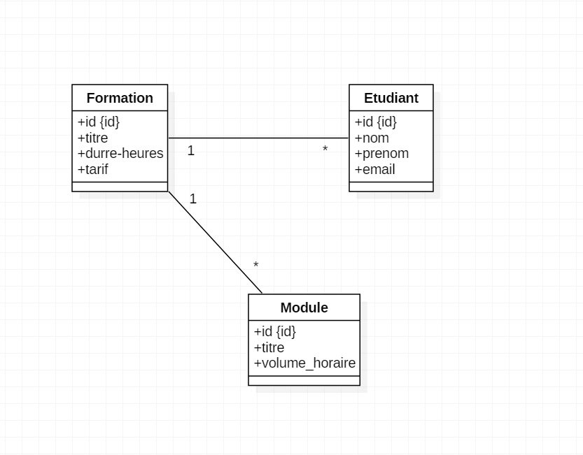
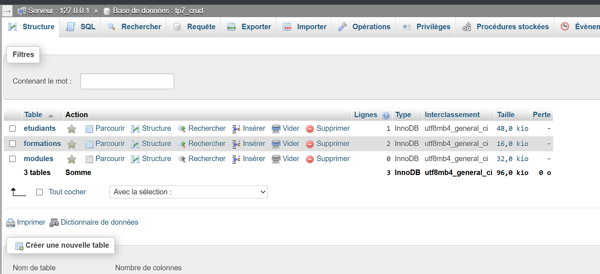
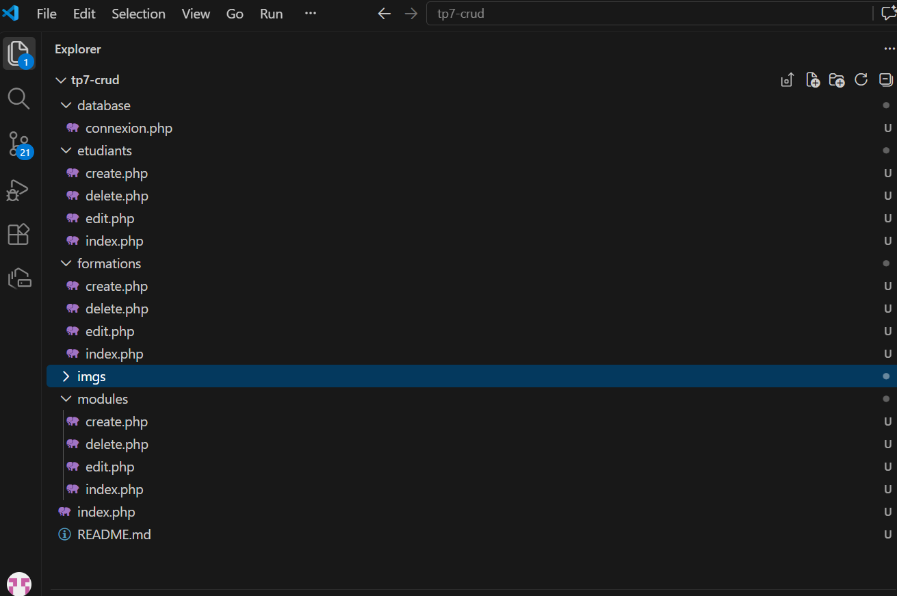
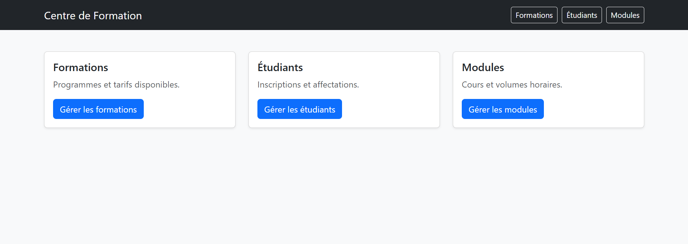
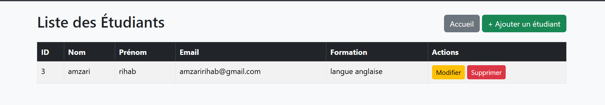
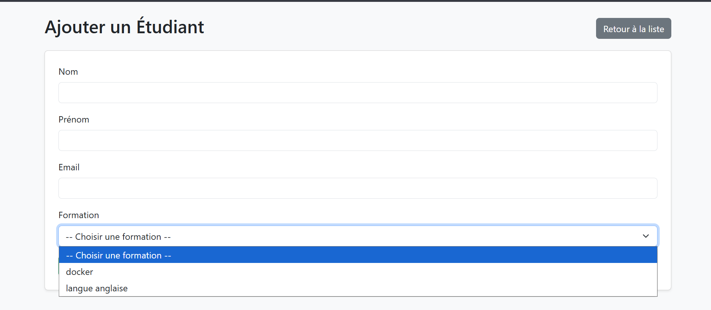

## centre de formation-CRUD 
on a modelise le probleme en utilisant un diagramme de classe 
 
on a cree une base de donnee sur XAMPP 
 
**la structure du projet** 
 
le dossier imgs est juste pour les images utilisee dans README.md 
**le projet en a glance** 
la page d'acceuil 

la page d'etudiant 

la formulaire a remplire par l'utilisateur 
 
**pour le style ,on a utiliser BOOTSTRAP**
